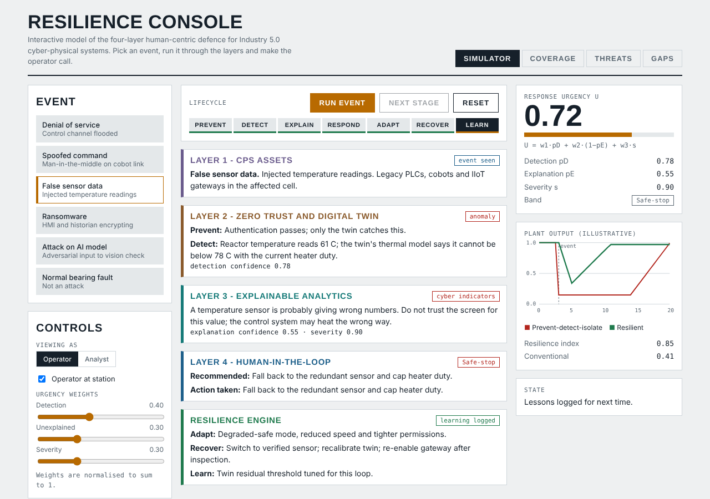

# Resilience Console

[](https://github.com/kav-cmd/resilience-console/actions/workflows/ci.yml)
[](LICENSE)

An interactive model of a four-layer, human-centric cybersecurity resilience architecture for **Industry 5.0 cyber-physical systems (CPS)**. Pick an attack, run it through the layers, and make the operator call.

**Live demo:** https://kav-cmd.github.io/resilience-console/



It is the companion to the paper *"A Unified Human-Centric Resilience Architecture for Cybersecurity in Industry 5.0 Cyber-Physical Systems"* (Pallavi, Patel, Kavya, Sridhar R; RV College of Engineering).

> **This is a teaching model, not a measured system.** All numbers are illustrative or are qualitative ratings from the paper's literature review.

## What it shows

| View | What you can do |
|---|---|
| **Simulator** | Run one of six events (DoS, spoofed command, false sensor data, ransomware, attack on an AI model, and a normal bearing fault) through the seven-stage lifecycle: Prevent, Detect, Explain, Respond, Adapt, Recover, Learn. Switch between *Operator* and *Analyst* explanations, tune the urgency weights, and toggle whether an operator is at the station. |
| **Coverage** | Heat map of how six reviewed approaches cover each lifecycle stage (0 to 3), with a per-stage mean. Detection is the best covered stage; Adapt and Recover are the least covered. |
| **Threats** | Threat, mechanism, CPS impact and defence table, plus a physical-consequence heat map. |
| **Gaps** | Four research gaps and the different needs of an operator and an OT analyst. |

### The four layers

1. **CPS assets**: sensors, PLCs, cobots, edge gateways.
2. **Zero trust and digital twin**: authentication, segmentation, twin consistency checks, anomaly detection.
3. **Explainable analytics**: plain-language explanations for the operator, technical ones for the analyst.
4. **Human-in-the-loop**: guarded override, so safety-affecting steps need operator confirmation.

A **resilience engine** cuts across them to adapt, recover and learn after the event.

### The urgency model

```
U = w1 * pD + w2 * (1 - pE) + w3 * s
```

`pD` is detection confidence, `pE` is explanation confidence (so `1 - pE` is how *unexplained* the event is), and `s` is severity. Weights are normalised to sum to 1. The result maps to a response band:

| U | Band | Meaning |
|---|---|---|
| >= 0.65 | Safe-stop | Needs operator confirmation, or happens automatically if nobody is at the station |
| 0.45 to 0.65 | Isolate | Contain the affected segment |
| < 0.45 | Monitor | Continue and watch |

See [docs/MODEL.md](docs/MODEL.md) for the plant-output curves and the resilience index.

## Run it locally

No build step. The page uses ES modules, so serve the folder over HTTP (opening `index.html` straight from disk will not load the scripts):

```bash
git clone https://github.com/kav-cmd/resilience-console.git
cd resilience-console
npx serve .            # or: python3 -m http.server 8080
```

## Tests

The model logic is pure (no DOM), so it is unit-tested with Node's built-in test runner. Node 22 or newer, no dependencies to install:

```bash
npm test
```

The tests check the urgency formula and band thresholds, the operator-override rules, the plant-output curves, and the integrity of all scenario and survey data.

## Project structure

```
index.html          page markup
css/style.css       theme (light and dark) and layout
js/data.js          scenarios, threat table, coverage matrix, gaps, personas
js/model.js         pure model: urgency, bands, override rules, curves
js/app.js           UI wiring and rendering
test/               unit tests for model.js and the data
docs/               model notes and screenshots
.github/workflows/  CI
```

## Editing the content

Scenarios, scores and text all live in [`js/data.js`](js/data.js). To add an event, add an object to `SC` with the same fields as the others (the tests will tell you if one is missing or a probability is out of range).

## Deploying

GitHub Pages serves the repo root. In **Settings, Pages**, set the source to *Deploy from a branch*, branch `main`, folder `/ (root)`.

## Citing

See [CITATION.cff](CITATION.cff), or use the "Cite this repository" button on GitHub.

## License

[MIT](LICENSE)
